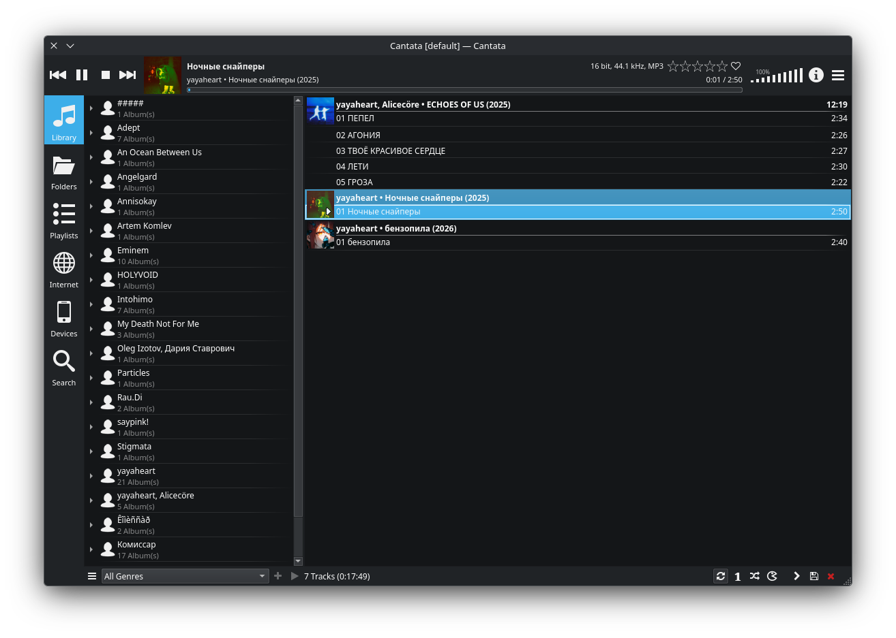

🎧 Cantata

🇺🇸 [English](README.md) | 🇷🇺 [Русский](README.ru.md)

> **NOTE**
> **Крейг Драммонд:** спустя 10 лет разработка Cantata прекращена, а этот репозиторий доступен только для чтения. Версия 2.5.0 — последняя выпущенная.

  
ℹ️ Графический (Qt6) клиент для MPD со следующими возможностями

  1. Поддержка Linux, macOS, Windows и Haiku. ПРИМЕЧАНИЕ: начиная с версии 2.3.3 активно поддерживается только Linux.
  2. Несколько коллекций MPD.
  3. Гибко настраиваемый интерфейс.
  4. Композиции (по желанию) группируются по альбомам в очереди воспроизведения.
  5. Контекстный вид с информацией об исполнителе, альбоме и композиции текущего трека.
  6. Простой редактор тегов.
  7. Органайзер файлов — упорядочивание файлов и папок на основе тегов.
  8. Возможность расчёта тегов ReplayGain (только Linux и при наличии необходимых библиотек).
  9. Динамические плейлисты.
  10. Умные плейлисты.
  11. Онлайн-сервисы: Jamendo, Magnatune, SoundCloud и подкасты.
  12. Поддержка интернет-радио — с возможностью поиска потоков через TuneIn, ShoutCast или Dirble.
  13. Поддержка устройств USB Mass Storage и MTP (только Linux и при наличии необходимых библиотек).
  14. Рипинг и воспроизведение аудио-CD (только Linux и при наличии необходимых библиотек).
  15. Воспроизведение композиций, не относящихся к MPD, через простой встроенный HTTP-сервер.
  16. Интерфейс MPRISv2 DBUS.
  17. Поддержка рейтингов.
  18. Поддержка «партиций».

Cantata начиналась как форк QtMPC, однако код (и пользовательский интерфейс) теперь очень сильно отличается от QtMPC.
Более подробную информацию см. в основном файле [README](README).
